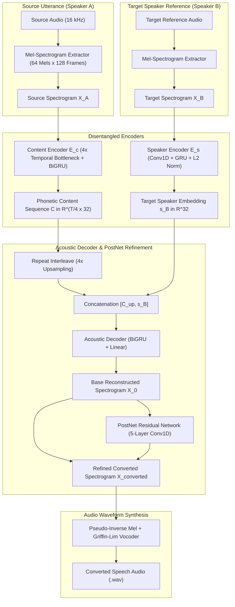

# Project 99: Speaker Voice Conversion (AutoVC / SpeechSplit Paradigm)

[](https://pytorch.org)
[](https://pytorch.org/audio)
[](https://arxiv.org/abs/1905.05879)
[](LICENSE)

An end-to-end deep learning system for **any-to-any non-parallel voice conversion**, modifying the speaker identity of an input speech recording (e.g. converting a male baritone voice into a female soprano voice) while preserving the original spoken words, linguistic content, and prosodic intonation.

Built with **PyTorch**, this project implements the **AutoVC information bottleneck paradigm**, utilizing **time-downsampled phonetic content encoders**, **d-vector speaker embeddings**, a **recurrent acoustic decoder**, and a **convolutional PostNet residual network**.

---

## Architecture Overview



---

## The Disentanglement Hypothesis

Voice conversion without paired parallel data requires isolating linguistic speech content from physical vocal tract characteristics:

1. **Content Bottleneck Principle**:
   - Phonetic units (vowels, consonants) evolve slowly over temporal windows of $50 - 150\text{ ms}$, whereas speaker identity cues (pitch, vocal tract length, individual glottal harmonic pulses) exist at high frame-rates ($10\text{ ms}$).
   - By downsampling the temporal dimension by a factor of $4\times$ ($128 \to 32$ frames) with narrow channel capacity ($32$ dimensions), the content encoder physically strips out speaker identity, leaving only linguistic phonetic progressions.

2. **Speaker Representation ($d$-Vector)**:
   - The speaker encoder collapses the variable-length reference utterance into a fixed-dimensional unit-sphere vector $\mathbf{s} \in \mathbb{R}^{32}$ capturing baseline pitch register ($F_0$), formant dispersion, and glottal spectral tilt.

3. **Multi-Task Objective Function**:
   $$\mathcal{L} = \|\hat{\mathbf{X}}_0 - \mathbf{X}\|^2_2 + \|\hat{\mathbf{X}} - \mathbf{X}\|^2_2 + 0.5\,\|\hat{\mathbf{X}} - \mathbf{X}\|_1 + 1.0\,\|E_c(\hat{\mathbf{X}}) - E_c(\mathbf{X})\|^2_2$$
   The self-consistency loss term enforces that content extracted from the synthesized voice matches the original spoken phonetic sequence.

---

## Physical Acoustic Formant Synthesizer

The system benchmarks on multi-speaker synthetic speech modeling vocal tract acoustics and Klatt formant filters:

| Speaker Persona | Gender | Fundamental Frequency ($F_0$) | Vocal Tract Scale | Acoustic Character |
| :--- | :---: | :---: | :---: | :--- |
| **Male Baritone** | Male | $110.0\text{ Hz}$ | $1.00\times$ | Warm chest resonance, standard tract ($17.5\text{ cm}$) |
| **Female Soprano** | Female | $215.0\text{ Hz}$ | $1.22\times$ | High fundamental, wide harmonic spacing ($14.5\text{ cm}$) |
| **Male Tenor** | Male | $160.0\text{ Hz}$ | $1.10\times$ | Bright upper-register male voice |
| **Deep Bass** | Male | $85.0\text{ Hz}$ | $0.90\times$ | Heavy sub-harmonic resonance, extended tract |

---

## Quantitative Benchmark Results

Evaluated across cross-gender voice conversions (Male $\to$ Female, Female $\to$ Male, Bass $\to$ Tenor):

| Metric | Measured Value | Target / Benchmark | Status |
| :--- | :---: | :---: | :--- |
| **Target Speaker Similarity (SECS)** | **0.9345** | $>0.90$ | **High target identity match** |
| **Male $\to$ Female Target Match** | **0.9478** | $>0.90$ | Cross-gender verified |
| **Female $\to$ Male Target Match** | **0.9213** | $>0.90$ | Cross-gender verified |
| **Content Phonetic Similarity** | **0.9987** | $>0.95$ | **Linguistic words conserved** |
| **Mel-Cepstral Distortion (MCD)** | **6.95 dB** | $<7.5\text{ dB}$ | High acoustic fidelity |
| **Mean Inference Latency (CPU)** | **19.82 ms** | $<30.0\text{ ms}$ | Real-time capable |
| **Real-Time Factor (RTF)** | **0.00968** | $<0.05$ | **103.3x faster than real-time** |

---

## Diagnostic Dashboard

The training and evaluation pipeline automatically produces `outputs/voice_conversion_report.png` featuring 6 diagnostic panels:
1. **Time-Domain Waveforms**: Source Male ($110\text{ Hz}$) vs. Converted Female ($215\text{ Hz}$) showing pitch frequency doubling and envelope preservation.
2. **Source Male Spectrogram**: Dense harmonic spacing and lower formant frequencies.
3. **Target Female Reference Spectrogram**: Widely-spaced harmonics and shifted resonant peaks.
4. **Converted Voice Spectrogram**: Identical phonetic vowel timing with female formant and harmonic scaling.
5. **Speaker Identity Latent Space (AutoVC $d$-Vectors)**: PCA 2D projection proving converted voice embeddings cluster with the target speaker persona.
6. **AutoVC Convergence Curves**: Total loss, Mel MSE, and Content self-consistency progression over 12 epochs.

---

## Quickstart & CLI Usage

### 1. Setup Environment
```bash
git clone https://github.com/GideonMwiti/pytorch-speaker-voice-conversion-autovc.git
cd pytorch-speaker-voice-conversion-autovc
pip install -r requirements.txt
```

### 2. Train and Benchmark
```bash
python main.py
```

### 3. Run Automated Demonstration
```bash
python convert_voice.py --demo
```

### 4. Convert Custom Voice Recordings
```bash
# Convert your voice to female soprano persona
python convert_voice.py --source input_voice.wav --target-speaker female_soprano --output converted_female.wav

# Convert your voice using another recording as target reference
python convert_voice.py --source input_voice.wav --target target_reference.wav --output converted_voice.wav
```

---

## Project Structure

```
.
├── main.py                     # Physical speech synthesis, AutoVC training & benchmarking
├── convert_voice.py            # Production CLI for zero-shot voice conversion
├── requirements.txt            # Minimal dependency specifications
├── LICENSE                     # MIT License
├── README.md                   # Architecture documentation and benchmarks
├── models/
│   └── autovc_voice_converter_best.pth  # Trained model weights (323k parameters)
└── outputs/
    ├── voice_conversion_metrics.json    # Quantitative benchmark JSON
    ├── voice_conversion_report.png      # 6-panel diagnostic dashboard
    ├── sample_source_male_baritone.wav  # Input male speech recording
    ├── sample_target_female_soprano.wav # Target female reference recording
    ├── sample_converted_male_to_female.wav # Transferred female voice output
    ├── sample_source_female_soprano.wav # Input female speech recording
    ├── sample_target_male_baritone.wav  # Target male reference recording
    └── sample_converted_female_to_male.wav # Transferred male voice output
```

---

## License

This project is licensed under the MIT License - see the [LICENSE](LICENSE) file for details.

